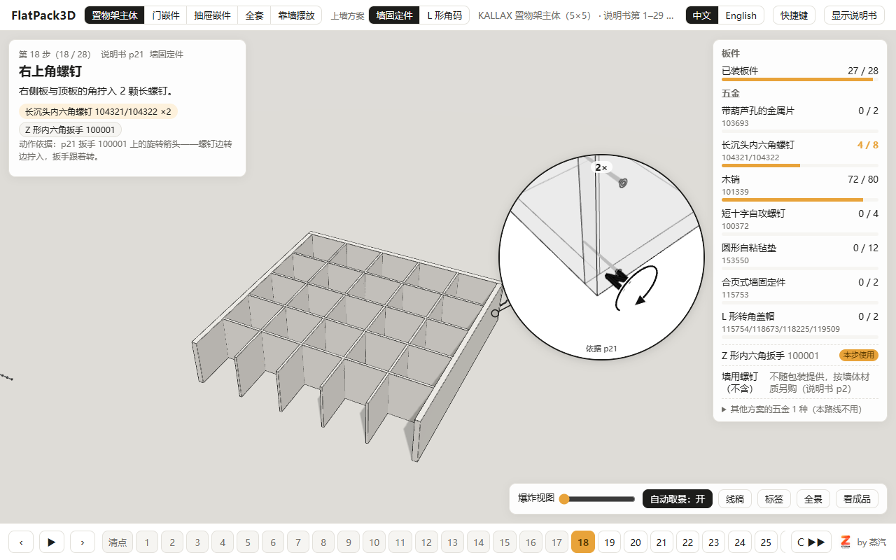
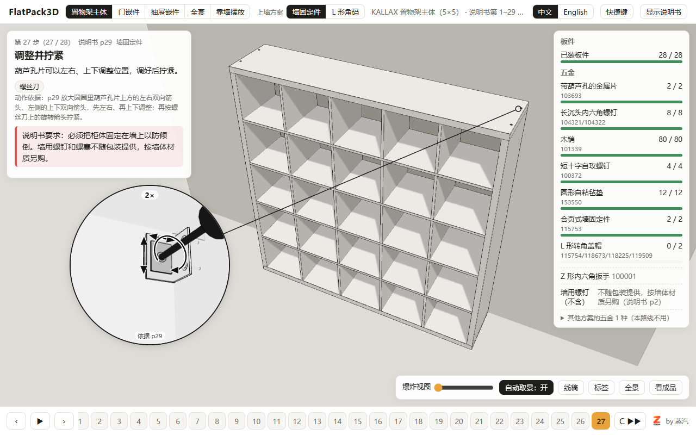
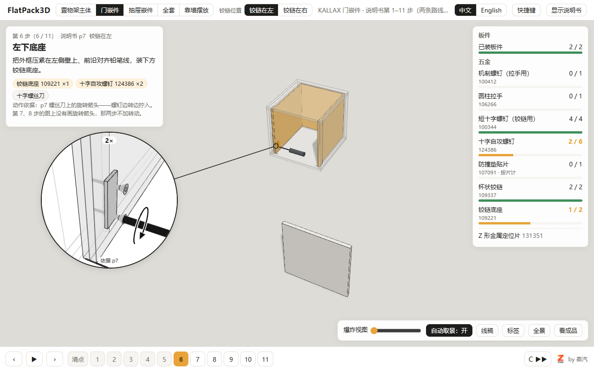
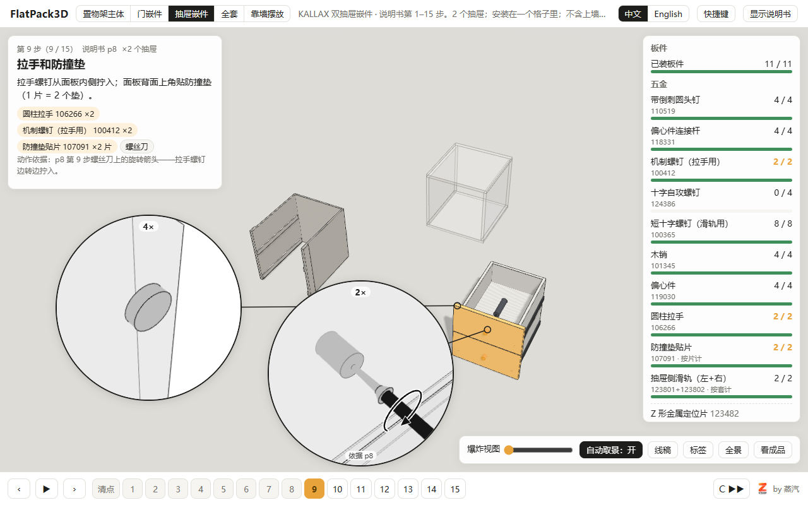
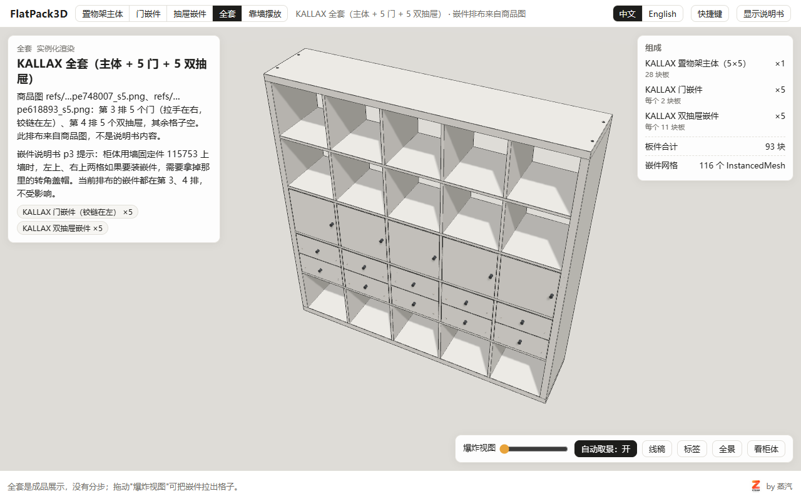
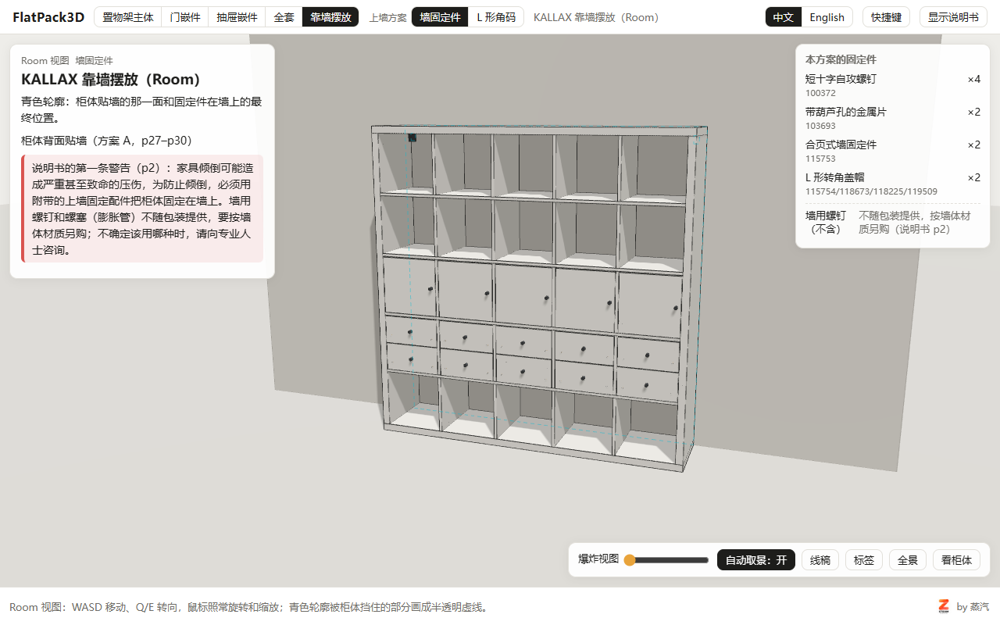

# 示例：宜家 KALLAX 置物架 + 门嵌件 + 双抽屉嵌件

这是 FlatPack3D 用本技能做出来的第一套 3D 说明书，产品 id 是 `kallax`，数据都在仓库的 `data/kallax/`。这里按 SKILL.md 的 8 个阶段，指出每个阶段在 KALLAX 里对应哪些文件、做到了什么程度，新产品照着做。

> 仓库里没有宜家的说明书 PDF、说明书页面图和商品图（版权归原厂）。要在本机对照页面图，把三份 PDF（下载地址在 `data/kallax/manifest.json`）放进 `manuals/kallax/`，运行 `node skills/manual-to-3d/scripts/flatpack.js render kallax`。

## 规模

| 件 | 说明书 | 零件 | 五金 | 步骤 | 路线 |
|---|---|---|---|---|---|
| 置物架主体 `body` | AA-2334148-2，36 页 | 28 块 | 9 种 112 件（不含工具） | 33（含两种上墙方案） | `a` 墙固定件 / `b` L 形角码 |
| 门嵌件 `door` | AA-1009339-8，16 页 | 2 件 | 8 种 17 件 | 20（两条路线） | `left` 铰链在左 / `right` 铰链在右 |
| 双抽屉嵌件 `drawer` | AA-1009361-5，12 页 | 11 件 | 11 种 36 件 | 15 | — |
| 全套 `set` | 商品图 | 主体 + 5 门 + 5 双抽屉 | | | |
| 靠墙摆放 `room` | | 全套靠墙，墙上青色轮廓 | | | 同主体的上墙方案 |

## 各阶段对应的文件

| 阶段 | 文件 | 看点 |
|---|---|---|
| 1 收资料 | `data/kallax/manifest.json` | 三份说明书的文件名、文档号、官方下载地址、页数；商品页用来取了什么（整体尺寸、嵌件尺寸、全套排布） |
| 2 只读分析 | `data/kallax/analysis.md` | 每份说明书一节：零件表、五金表、按页步骤表（两种上墙方案分表，右铰链路线写成列表）；"看不清或不确定的地方"一节；后来按 2 倍分辨率复查的结论（p27 三个缩略图、"2x"的含义、铰链在哪一侧、动作箭头逐页清单）另起一节 |
| 3 尺寸 | `data/kallax/dimensions.md`（英文 `dimensions.en.md`） | 宜家说明书没有尺寸数字：整体尺寸来自商品页，板厚由"总宽 = 2 × 外框 + 5 × 格 + 4 × 内板"反推，其他都进猜测清单（49 条，按开发阶段分组） |
| 4 数据 | `data/kallax/build/lib.js`、`body.js`、`inserts.js` → `body.json`、`door.json`、`drawer.json`、`set.json`、`room.json` | 尺寸常量集中在 `lib.js`；`body.js` 一步一步写步骤、五金摆放、上墙两种方案、动作（只给画了箭头的步骤）；`inserts.js` 写门、抽屉、全套和 Room |
| 5 接入引擎 | `renders/framing/kallax/`（本机生成，不入库） | 306 张中文截图 + 204 张英文截图全部合格 |
| 6 视觉复查 | `exports/review/kallax/`（本机生成，不入库） | 每个件一张对照图；自己发现并改掉的问题见下面"踩过的坑" |
| 7 文案 | `product.zh.json`、`product.en.json`、`site.json`、`site.en.json`、`i18n/*.en.json` | 安全提示转述 p2 的警告（`safety.page = 2`）；商标声明；近似说明指向猜测清单；部件英文名写明是描述性译名 |
| 8 发布前检查 | `skills/manual-to-3d/references/release-checklist.md` | |

## 截图（3D 部分，截图时隐藏了说明书面板）

| | |
|---|---|
|  |  |
| 主体第 18 步 | 主体方案 A 第 27 步 |
|  |  |
| 门嵌件第 6 步 | 抽屉第 9 步（两处小零件，开两个圆圈） |
|  |  |
| 全套 | 靠墙摆放（Room） |

截图命令：`node scripts/review/screens.js skills/manual-to-3d/examples/kallax/screens kallax body:a:18 body:a:27 door:left:6 drawer:9 set room:a`

## 踩过的坑（详见 `references/pitfalls.md`）

- p28、p32 的"2x"是两个固定件各做一次、每个 1 颗墙钉，不是每个 2 颗。
- 门嵌件两条路线先按"左开/右开"命名，对照 p9、p14 后改成"铰链在左/铰链在右"。
- 第 18 步的放大圆圈起初只看到两块灰色板面，动画结束时只剩一个点；改成线稿、3.5 倍视野、半透明切面、动作循环，并按对照图逐行复查。
- 第 27 步起初圈里只有一块方片：改成从格子里朝角落看，画出 p29 的双向箭头，螺丝刀画成实心黑色。
- 截图检查的调试端口写死，两个检查同时跑时互相干扰；对照图截图按时间等待不可靠，改用虚拟时钟。
